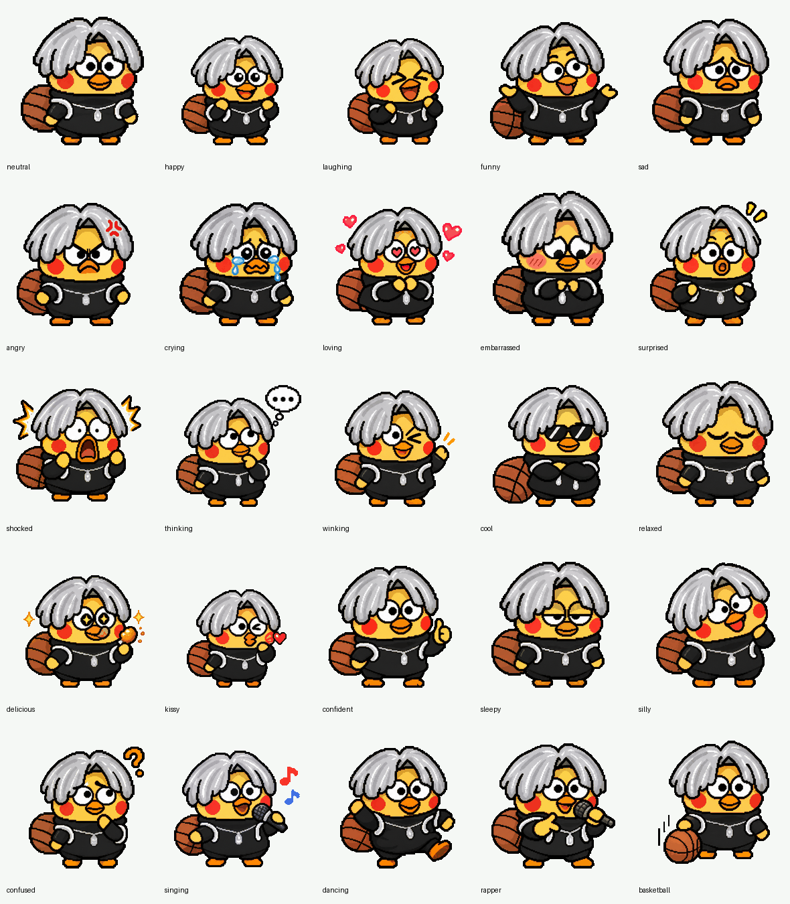

# 宗主 · IKUN 圆屏语音助手

基于小智 ESP32 v2.5.2，为 **Waveshare ESP32-S3-Touch-AMOLED-1.75C** 定制的固件，版本 **2.5.2.2**。使用官方小智服务，唤醒词为 **“你好宗主”**。


上图来自真实开发板的 LVGL 渲染截图；英文 `neutral` 是验证程序的状态标签，正式固件下方显示对话字幕。

## 功能

- 466×466 圆屏布局：顶部状态和底部字幕移入安全区域，长字幕换行、滚动。
- 银色中分、黑卫衣的 IKUN 形象；21 种独立情绪，每种 4 帧。
- 另外提供唱歌、跳舞、Rap、篮球 4 组动画；保留聆听和说话状态动画。
- 板端使用 MultiNet7 中文模型识别“你好宗主”。
- `self.zongzhu.play_animation` 工具播放指定表演 12 秒，结束后恢复状态动画。
- 继续使用官方服务及原板的触摸、音频和电源管理。

情绪列表：neutral、happy、laughing、funny、sad、angry、crying、loving、embarrassed、surprised、shocked、thinking、winking、cool、relaxed、delicious、kissy、confident、sleepy、silly、confused。



## 适用硬件

仅在 **1.75C** 上完成验证：ESP32-S3、8 MB PSRAM、466×466 CO5300 AMOLED、CST9217 触摸、ES8311 / ES7210 音频。验证设备有 32 MB Flash，本包沿用上游前 16 MB 分区布局。不要将名称相似的无 C 版本当成相同板型。

## 使用现成固件

安装 [esptool](https://github.com/espressif/esptool)，连接开发板并确定串口，在以下目录校验文件：

```sh
cd firmware/zongzhu-1.75c-2.5.2.2
shasum -a 256 -c SHA256SUMS
# Linux 可使用 sha256sum -c SHA256SUMS
esptool --chip esp32s3 --port YOUR_PORT --baud 921600 write-flash @flash_args
```

将 `YOUR_PORT` 替换为实际串口，例如 macOS 的 `/dev/cu.usbmodem...`、Linux 的 `/dev/ttyACM0` 或 Windows 的 `COM3`。首次修改已有设备前应自行备份。

安装包包含 bootloader、原分区表、OTA 初始选择、应用和动画/语音/字体资源。**不包含 NVS、Wi-Fi 密码或设备绑定信息，也不执行整片擦除。** 本包会更新应用、资源并选择 ota_0；只用于兼容的上游分区布局。

重启后使用设备配网页面加入 2.4 GHz Wi-Fi。OTA 地址保持 `https://api.tenclass.net/xiaozhi/ota/`，在 [xiaozhi.me](https://xiaozhi.me/) 添加或使用已有设备。

官方未来 OTA 更新可能覆盖定制界面和唤醒配置；本目录的安装包可用于恢复此版本。

## 官方角色设置

在小智控制台将智能体名称设为“宗主”，角色介绍可加入：

> 你叫宗主，爱好唱、跳、Rap、篮球。屏幕形象是银色中分、黑卫衣的 IKUN。用户让你唱歌、跳舞、Rap 或打篮球时，如果设备提供 self.zongzhu.play_animation 工具，先调用它显示对应动画：singing、dancing、rapper、basketball，再自然回应。工具只播放屏幕动画，不代表已播放歌曲或真实完成运动；没有工具时不要声称已显示动画。

自定义名字和角色介绍不会替代固件里的唤醒模型；本固件已经配置“你好宗主”。表演工具仅控制画面，不能据此判断音频歌曲是否播放。

## 从源码构建

安装并导出 ESP-IDF 6.0.1 或兼容环境。本版本使用 ESP-IDF 6.0.1 构建，项目最低要求为 6.0.1。建议将仓库克隆到不含中文的路径，避免工具链路径问题。

```sh
cd xiaozhi-esp32
python scripts/build.py waveshare/esp32-s3-touch-amoled-1.75 --name esp32-s3-touch-amoled-1.75c --language zh-CN
python -m unittest discover -s scripts/tests -v
```

主要改动：

| 路径（相对于 xiaozhi-esp32） | 用途 |
| --- | --- |
| `main/boards/waveshare/esp32-s3-touch-amoled-1.75/ikun_round_display.h` | 圆屏布局、情绪、字幕滚动和表演恢复 |
| 同目录 `config.json` | 1.75C 唤醒词及模型配置 |
| 同目录 `esp32-s3-touch-amoled-1.75.cc` | 板级显示适配和表演工具 |
| 同目录 `ikun/` | 板端 GIF 动画 |
| `main/CMakeLists.txt` | 额外资源打包及依赖跟踪 |

原始 2×2 图集在 `assets/ikun-v2/generated/`。需要重新导出动画时，在仓库根目录运行：

```sh
python -m pip install Pillow==12.3.0
python assets/ikun-v2/export_firmware.py
```

导出脚本同时更新板端 GIF、预览和 `animations.json`。原有宠物图集与导出脚本位于 `assets/ikun/`，用于已有状态动画和嵌入式回退资源。

## 验证范围

2026-10-15 完成的验证：

- ESP-IDF 构建成功，110 项上游主机测试通过。
- 开发板上注入 6 组合成 PCM：3 组新唤醒词成功，2 组旧唤醒词和 1 组普通话语未触发。这是有限样本验证，不是唤醒准确率评测。
- 25 种动画成功解码，表演期间不会被普通情绪覆盖，12 秒后恢复。
- 5 个正式固件分段写入哈希一致；正式包已移除测试注入和测试音频。
- 正式启动版本 2.5.2.2，官方 OTA 检查成功；串口记录真实麦克风唤醒、识别提问和官方回复。
- 用户现场确认“能唤醒、有回复、会跳舞”。本次串口采集没有单独记录 dancing 调用，跳舞体验以用户现场确认作为证据。

结构化板端结果见 [hardware-qa.json](assets/ikun-v2/hardware-qa.json)。原始设备备份、账号截图和对话日志不在仓库内。

应用大小 2,953,520 字节，资源大小 7,183,331 字节，均在原分区容量内。未验证其他板型；其他人的声音、距离、噪声及网络环境仍可能影响体验。

## 来源

完整上游来源及变更范围见 [UPSTREAM.md](UPSTREAM.md)，代码保留 [MIT 许可证](LICENSE)。本仓库是个人定制项目，不是小智、Waveshare 或相关人物的官方产品。
